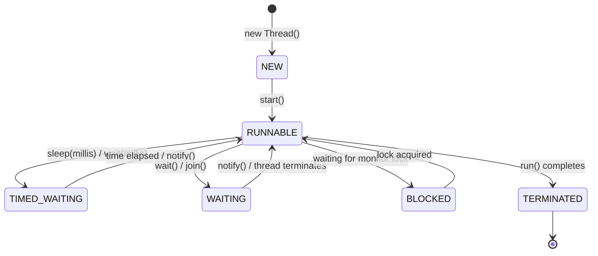

# Experiment 07: Implementation of Multithreading Operations

## Overview of Multithreading
Multithreading in Java is a feature that allows concurrent execution of two or more parts of a program for maximum utilization of CPU. Each part of such a program is called a thread.

### Thread Creation
In these programs, threads are created by extending the `java.lang.Thread` class and overriding its `run()` method.

### Key Thread Methods
- `start()`: Allocates memory, registers thread with the thread scheduler, and executes the `run()` method.
- `run()`: Entry point for the thread execution code.
- `sleep(long millis)`: Causes the currently executing thread to pause execution for the specified time in milliseconds (moves thread to `TIMED_WAITING` state).
- `yield()`: Hints to the thread scheduler that the current thread is willing to yield its current use of processor time to other threads of equal priority.
- `join()`: Allows one thread to wait until another thread finishes its execution.

### Java Thread Lifecycle


---

## Program 1: ThreadPrintControl.java

### Aim
Create 2 threads where Thread 1 prints 1 to 10 and Thread 2 reads numbers from 10 to 1, with Thread 1 yielding control after printing the second number.

### Concept
Extending `Thread` class, overriding `run()`, and using `Thread.yield()` for thread switching.

### Working
1. `FirstThread` starts and prints numbers 1 and 2.
2. Upon reaching 2, it invokes `Thread.yield()` to voluntarily transfer control to `SecondThread`.
3. `SecondThread` prints numbers from 10 down to 1.
4. `FirstThread` resumes and prints remaining numbers from 3 to 10.
5. Both threads terminate upon completion of their respective loops.

### Sample Output
```text
Thread 1 (1 to 10): 1
Thread 1 (1 to 10): 2
Thread 2 (10 to 1): 10
Thread 2 (10 to 1): 9
Thread 2 (10 to 1): 8
...
Thread 1 (1 to 10): 3
...
```

### Execution
```bash
javac ThreadPrintControl.java
java ThreadPrintControl
```

---

## Program 2: OddEvenThreads.java

### Aim
Create 2 threads where one thread prints odd numbers and the other thread prints even numbers from 1 to 20.

### Concept
Multithreading with concurrent loops and `Thread.sleep()` to simulate balanced interleaved execution.

### Working
1. `OddThread` and `EvenThread` are instantiated and started using `start()`.
2. `OddThread` executes a loop starting at 1 incremented by 2, printing odd numbers up to 19.
3. `EvenThread` executes a loop starting at 2 incremented by 2, printing even numbers up to 20.
4. Each thread sleeps for 50 milliseconds between numbers to allow the scheduler to interleave both threads.
5. Once both loops reach 20, both threads complete execution.

### Sample Output
```text
Odd Thread: 1
Even Thread: 2
Odd Thread: 3
Even Thread: 4
...
Odd Thread: 19
Even Thread: 20
```

### Execution
```bash
javac OddEvenThreads.java
java OddEvenThreads
```

---

## Program 3: ThreadSleepControl.java

### Aim
Create 2 threads where Thread 1 prints 10 to 20 and Thread 2 reads numbers from 20 to 1, with Thread 1 transferring control after printing the second number using `sleep()`.

### Concept
Thread coordination using `Thread.sleep()` to pause a thread and yield processor time to a concurrent thread.

### Working
1. `RangeUpThread` (prints 10 to 20) and `RangeDownThread` (prints 20 to 1) are started.
2. `RangeUpThread` prints 10 and 11.
3. Upon printing 11 (the second number), it calls `Thread.sleep(500)`.
4. While `RangeUpThread` is in `TIMED_WAITING`, `RangeDownThread` takes execution control and prints numbers from 20 down to 1.
5. `RangeUpThread` wakes up and finishes printing numbers from 12 to 20.

### Sample Output
```text
Thread 1 (10 to 20): 10
Thread 1 (10 to 20): 11
Thread 2 (20 to 1): 20
Thread 2 (20 to 1): 19
...
Thread 2 (20 to 1): 1
Thread 1 (10 to 20): 12
...
Thread 1 (10 to 20): 20
```

### Execution
```bash
javac ThreadSleepControl.java
java ThreadSleepControl
```
