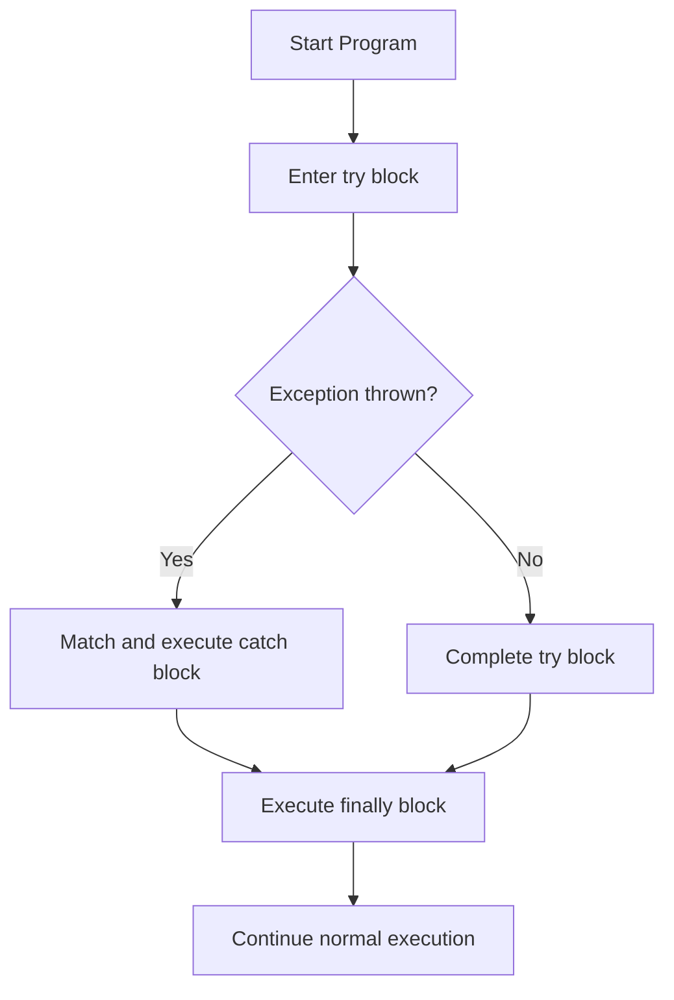

# Experiment 08: Implementation of try, catch, and finally Blocks

## Overview
Exception handling in Java allows a program to handle runtime errors smoothly without abnormal termination. The `try` block encloses code that may throw an exception, `catch` handles specific exceptions, and `finally` always executes regardless of whether an exception occurred.

### Exception Handling Flowchart


---

## Program 1: DivideByZeroDemo.java

### Aim
Catch an `ArithmeticException` when a division by zero situation occurs in a program.

### Concept
Handling runtime arithmetic errors using `try`, `catch(ArithmeticException)`, and cleanup in `finally`.

### Working
1. Prompts the user to enter two integers (numerator and denominator).
2. The division `numerator / denominator` is performed inside the `try` block.
3. If the denominator is 0, the JVM creates and throws an `ArithmeticException`.
4. The matching `catch` block intercepts the exception and prints an error message.
5. The `finally` block executes unconditionally and closes the `Scanner`.

### Sample Output
```text
Enter numerator: 10
Enter denominator: 0
Exception caught: Cannot divide by zero.
Finally block executed.
```

### Execution
```bash
javac DivideByZeroDemo.java
java DivideByZeroDemo
```

---

## Program 2: ArrayIndexOutOfBoundsDemo.java

### Aim
Catch an `ArrayIndexOutOfBoundsException` when the array index accessed goes beyond the defined size.

### Concept
Validating array access bounds using `try-catch-finally`.

### Working
1. An integer array of size 5 (indices 0 to 4) is initialized.
2. The user is prompted to enter an index to retrieve.
3. If the user enters an index `< 0` or `>= 5`, the JVM throws an `ArrayIndexOutOfBoundsException`.
4. The `catch` block intercepts the exception and prevents program crashing.
5. The `finally` block runs to conclude the array access operation.

### Sample Output
```text
Array length: 5 (valid indices: 0 to 4)
Enter index to access: 7
Exception caught: Array index is out of bounds.
Finally block executed: Array operation finished.
```

### Execution
```bash
javac ArrayIndexOutOfBoundsDemo.java
java ArrayIndexOutOfBoundsDemo
```
