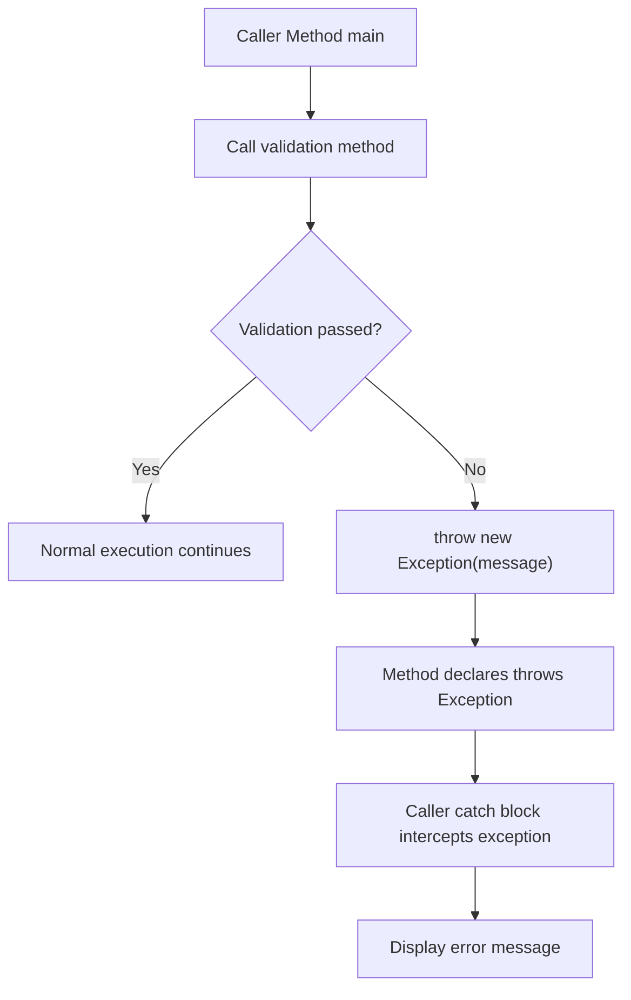

# Experiment 09: Implementation of throw and throws

## Overview
- `throw`: Used to explicitly throw an exception object from any method or block.
- `throws`: Used in method signatures to declare that the method might throw the listed exceptions, requiring caller handling or propagation.

### Throw and Throws Flow


---

## Program 1: PasswordAuthDemo.java

### Aim
Accept a password from the user and throw an `"Authentication Failure!"` exception if the password is incorrect.

### Concept
Explicit exception generation using `throw` and declaration using `throws`.

### Working
1. Prompts user to input a password string.
2. Passes password to static method `checkPassword()`.
3. If password does not match `"admin123"`, executes `throw new Exception("Authentication Failure!")`.
4. Method signature marks `throws Exception`.
5. The `main` method catches the thrown exception and prints `Authentication Failure!`.

### Sample Output
```text
Enter password: wrongpass
Error: Authentication Failure!
```

### Execution
```bash
javac PasswordAuthDemo.java
java PasswordAuthDemo
```

---

## Program 2: EvenNumberCheckDemo.java

### Aim
Accept a number from the user and throw an exception if the number is not even.

### Concept
Validating condition and throwing `IllegalArgumentException` with `throw` and `throws`.

### Working
1. Accepts an integer from user input.
2. Invokes `checkEven(number)`.
3. Tests condition `number % 2 != 0`.
4. If odd, throws `IllegalArgumentException` stating that the number is not even.
5. `main` catches the exception and outputs the message.

### Sample Output
```text
Enter an integer: 7
Exception: Number is not even: 7
```

### Execution
```bash
javac EvenNumberCheckDemo.java
java EvenNumberCheckDemo
```
