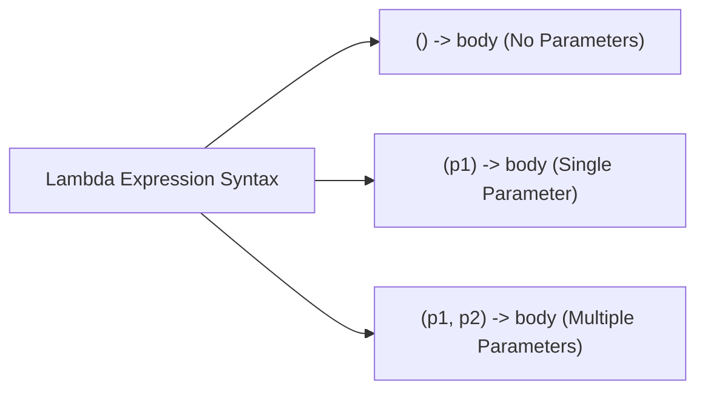

# Experiment 11: Demonstration of Lambda Expressions

## Overview
A lambda expression is a short block of code which takes in parameters and returns a value. Introduced in Java 8, lambda expressions provide a clear and concise way to implement Single Abstract Method (SAM) interfaces (Functional Interfaces).

### Lambda Syntax Forms


---

## Program: LambdaDemo.java

### Aim
Demonstrate lambda expressions with no parameters, single parameter, and multiple parameters using custom functional interfaces.

### Concept
Java 8 lambda expression syntax implementing functional interfaces annotated with `@FunctionalInterface`.

### Working
1. Defines three functional interfaces:
   - `MyInterface` with SAM `show()` (0 parameters).
   - `MyMIT` with SAM `show1(int a)` (1 parameter).
   - `MyCode` with SAM `show2(int a, int b)` (2 parameters).
2. Assigns a lambda `() -> System.out.println(...)` to `obj` and calls `obj.show()`.
3. Assigns a lambda `(a) -> System.out.println(...)` to `obj1` and calls `obj1.show1(10)`.
4. Assigns a lambda `(a, b) -> System.out.println(...)` to `obj2` and calls `obj2.show2(5, 3)`.
5. Outputs the evaluated lambda expressions.

### Sample Output
```text
No parameter is called
One parameter is called: 10
Addition: 8
```

### Execution
```bash
javac LambdaDemo.java
java LambdaDemo
```
