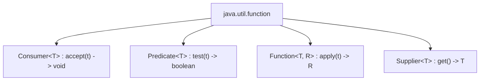

# Experiment 12: Implementation of Functional Interfaces

## Overview
A functional interface is an interface that contains exactly one abstract method (Single Abstract Method - SAM). Java 8 provides built-in functional interfaces in the `java.util.function` package.

### Built-in Functional Interfaces Summary


---

## Program 1: FunctionalInterfaceDemo.java

### Aim
Demonstrate the implementation of a custom user-defined functional interface using the `@FunctionalInterface` annotation and a lambda expression.

### Concept
Single Abstract Method interface implementation via lambda expression without an explicit implementation class.

### Working
1. Declares `@FunctionalInterface interface Greeting` with SAM `void greet(String message)`.
2. Instantiates `Greeting` using lambda `msg -> System.out.println("Greeting: " + msg)`.
3. Calls `g.greet("Welcome to Java Functional Interfaces")`.
4. Executes the method and prints the formatted string.

### Sample Output
```text
Greeting: Welcome to Java Functional Interfaces
```

### Execution
```bash
javac FunctionalInterfaceDemo.java
java FunctionalInterfaceDemo
```

---

## Program 2: PredefinedFunctionalInterfaces.java

### Aim
Demonstrate Java's four core built-in functional interfaces: `Consumer`, `Predicate`, `Function`, and `Supplier`.

### Concept
Using standard Java 8 functional types from `java.util.function`.

### Working
1. `Consumer<String>`: Accepts a string via `c.accept("Hello Java")` and prints it with no return.
2. `Predicate<Integer>`: Evaluates condition `n > 10` on input 15 and returns `true`.
3. `Function<Integer, Integer>`: Takes integer 5 and computes square `5 * 5 = 25`.
4. `Supplier<String>`: Takes no arguments and produces string `"Hello World"` via `s.get()`.

### Sample Output
```text
Hello Java
true
25
Hello World
```

### Execution
```bash
javac PredefinedFunctionalInterfaces.java
java PredefinedFunctionalInterfaces
```
