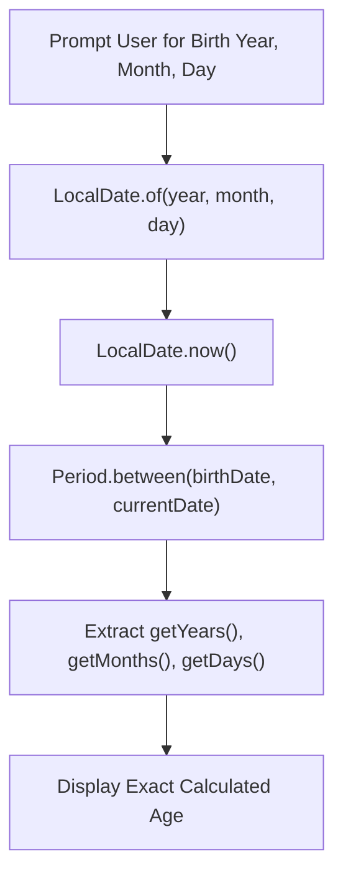

# Experiment 13: Demonstration of Date and Time API (Age Calculator)

## Overview
Java 8 introduced the modern `java.time` package (inspired by Joda-Time) which is immutable, thread-safe, and provides comprehensive calendar calculations using `LocalDate` and `Period`.

### Age Calculation Workflow


---

## Program: AgeCalculatorDemo.java

### Aim
Calculate and display a person's exact age in years, months, and days using Java Time API (`LocalDate` and `Period`).

### Concept
`java.time.LocalDate` represents date without time-zone, and `java.time.Period` calculates date-based distance between two points in time.

### Working
1. Prompts the user to enter their birth year, birth month, and birth day using `Scanner`.
2. Constructs the birth date object using `LocalDate.of(year, month, day)`.
3. Obtains today's current date using `LocalDate.now()`.
4. Computes the elapsed duration using `Period.between(birthDate, currentDate)`.
5. Extracts and prints `age.getYears()`, `age.getMonths()`, and `age.getDays()`.

### Sample Output
```text
Enter birth year (e.g. 2004): 2004
Enter birth month (1-12): 5
Enter birth day (1-31): 15
Current Date: 2026-10-31
Birth Date: 2004-05-15
Calculated Age: 22 years, 5 months, and 16 days.
```

### Execution
```bash
javac AgeCalculatorDemo.java
java AgeCalculatorDemo
```
