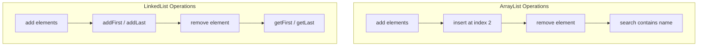

# Experiment 14: Implementation of List Interface (ArrayList and LinkedList)

## Overview
The `List` interface in Java Collections Framework represents an ordered collection (sequence) that allows duplicates and positional access by index.
- `ArrayList`: Resizable array implementation with fast random access (`O(1)`).
- `LinkedList`: Doubly-linked list implementation with fast insertions and deletions at ends (`O(1)`).

### List Operations Comparison


---

## Program 1: ArrayListExample.java

### Aim
Demonstrate `ArrayList` by adding student names, inserting at a specific index, removing an element, searching for a name, and iterating through the list.

### Concept
`java.util.ArrayList` dynamic array methods: `add()`, `add(index, element)`, `remove()`, and `contains()`.

### Working
1. An `ArrayList<String>` is instantiated and populated with 4 student names.
2. The list is displayed using an enhanced for-loop.
3. `"Neha"` is inserted at index 2 using `students.add(2, "Neha")`.
4. `"Amit"` is removed using `students.remove("Amit")`.
5. The user is prompted to enter a student name to search using `students.contains(name)`.

### Sample Output
```text
Student Names: Rahul Priya Amit Sneha 
After adding Neha: [Rahul, Priya, Neha, Amit, Sneha]
After removing Amit: [Rahul, Priya, Neha, Sneha]
Enter name to search: Priya
Present
```

### Execution
```bash
javac ArrayListExample.java
java ArrayListExample
```

---

## Program 2: LinkedListExampleDemo.java

### Aim
Demonstrate `LinkedList` operations including positional insertion (`addFirst`, `addLast`), deletion, boundary retrieval (`getFirst`, `getLast`), and size checking.

### Concept
`java.util.LinkedList` doubly-linked list methods for efficient head/tail manipulations.

### Working
1. A `LinkedList<String>` is created and initial student names are added.
2. `addFirst("Neha")` prepends Neha to the head of the list.
3. `addLast("Rohan")` appends Rohan to the tail of the list.
4. `remove("Amit")` removes the first occurrence of Amit.
5. Verifies membership with `contains("Priya")`, queries head with `getFirst()`, tail with `getLast()`, and length with `size()`.

### Sample Output
```text
Original LinkedList: [Rahul, Priya, Amit, Sneha]
After adding first: [Neha, Rahul, Priya, Amit, Sneha]
After adding last: [Neha, Rahul, Priya, Amit, Sneha, Rohan]
After removing Amit: [Neha, Rahul, Priya, Sneha, Rohan]
Priya is present in the list
First student: Neha
Last student: Rohan
Total students: 5
Student Names: Neha Rahul Priya Sneha Rohan 
```

### Execution
```bash
javac LinkedListExampleDemo.java
java LinkedListExampleDemo
```
