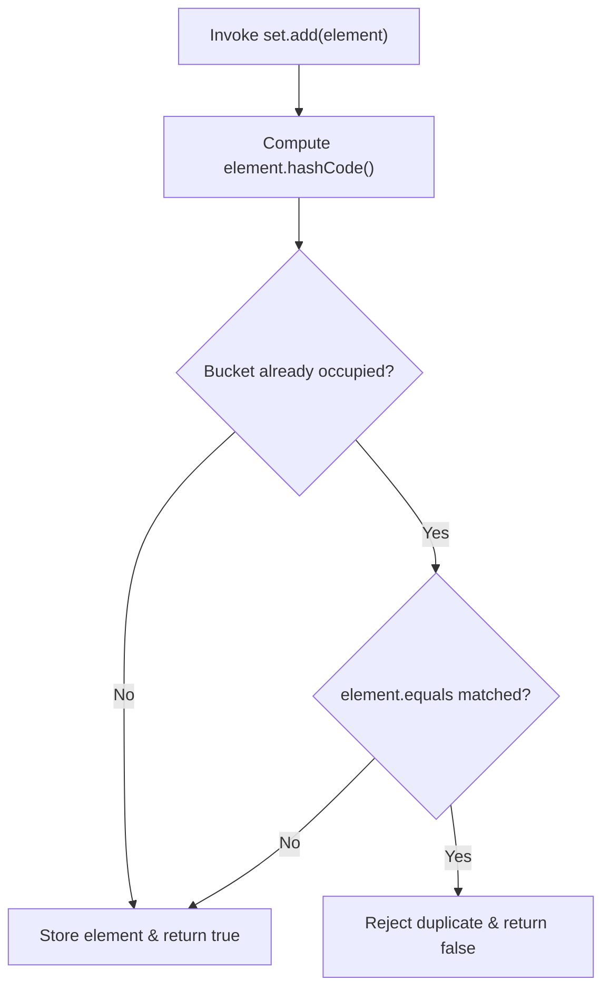

# Experiment 15: Implementation of Set Interface (HashSet)

## Overview
The `Set` interface models the mathematical set abstraction. A `Set` is an unordered collection that cannot contain duplicate elements. `HashSet` is backed by a hash table (`HashMap` instance), offering constant-time `O(1)` performance for basic operations.

### Duplicate Rejection Flowchart


---

## Program: HashSetExample.java

### Aim
Store student names in a `HashSet` and perform insertion, deletion, searching, display, and demonstrate that duplicate elements are not allowed.

### Concept
Uniqueness guarantee and hashing mechanics of `java.util.HashSet`.

### Working
1. Instantiates a `HashSet<String>` and inserts `"Rahul"`, `"Priya"`, `"Amit"`, and `"Sneha"`.
2. Attempts to insert `"Rahul"` a second time; the set detects the existing hash and duplicate, returning `false` and maintaining set size.
3. Removes `"Amit"` from the set using `students.remove("Amit")`.
4. Tests existence of `"Priya"` with `students.contains("Priya")`.
5. Prints the size using `students.size()` and iterates over the elements using an enhanced for-loop.

### Sample Output
```text
Original HashSet: [Rahul, Priya, Amit, Sneha]
After adding duplicate (Rahul): [Rahul, Priya, Amit, Sneha]
After removing Amit: [Rahul, Priya, Sneha]
Priya is present in the set
Total students: 3
Student Names: 
Rahul
Priya
Sneha
```

### Execution
```bash
javac HashSetExample.java
java HashSetExample
```
